<picture>
  <source media="(prefers-color-scheme: dark)" srcset="https://raw.githubusercontent.com/sharmaasahill/sharmaasahill/main/.github/readme/banner-dark.svg">
  <source media="(prefers-color-scheme: light)" srcset="https://raw.githubusercontent.com/sharmaasahill/sharmaasahill/main/.github/readme/banner-light.svg">
  
</picture>

<p align="center">
  <a href="https://sharmaasahill.vercel.app">Portfolio</a> ·
  <a href="https://www.linkedin.com/in/sharmaasahill/">LinkedIn</a> ·
  <a href="mailto:i.sahilkrsharma@gmail.com">Email</a> ·
  <a href="https://sharmaasahill.vercel.app/_Sahil_Sharma_Software_Engineer_Resume.pdf">Résumé (PDF)</a>
</p>

<p align="center"><sub>
  <a href="#00--prompt">prompt</a> → <a href="#01--context">context</a> → <a href="#02--production">production</a> → <a href="#03--builds">builds</a> → <a href="#04--toolchain">toolchain</a> → <a href="#05--handoff">handoff</a>
</sub></p>

### 00 · prompt

> Most AI demos stop at the answer. I build the part after it: validation, bounded retries, and a person on the risky step.

### 01 · context

I'm Sahil, a Cloud Application Engineer at Tata Consultancy Services in Bengaluru. Most of my day is Python on AWS: Bedrock prompts that turn a plain-English request into a filtering rule, DynamoDB tables that remember where every batch got to, and Amazon Connect flows that decide where a customer's call goes.

After hours I build agentic tools, retrieval-grounded assistants and ML apps. Each one ships with tests and CI, and most have a live URL.

**House rules**

1. **Check what the model says.** Every LLM output fills a schema and is validated before anything acts on it.
2. **Do the arithmetic in code.** Scores, totals and ATS points are added up in Python. A model can't get a sum wrong if it never does one.
3. **Fail over, not down.** Rate limits, timeouts and overloads move a call to the backup model. A bad API key fails at once.
4. **Measure before claiming.** Accuracy comes from labelled cases or data the model never saw, and it reruns in CI when a prompt changes.
5. **Keep a person on the risky step.** Anything that writes or sends waits in an approval queue.

### 02 · production

<picture>
  <source media="(prefers-color-scheme: dark)" srcset="https://raw.githubusercontent.com/sharmaasahill/sharmaasahill/main/.github/readme/trace-dark.svg">
  <source media="(prefers-color-scheme: light)" srcset="https://raw.githubusercontent.com/sharmaasahill/sharmaasahill/main/.github/readme/trace-light.svg">
  
</picture>

| where | what changed |
| :-- | :-- |
| **Tata Consultancy Services**<br><sub>Cloud Application Engineer<br>Dec 2025 → now</sub> | An Amazon Bedrock (Claude, Nova) pipeline turns plain-English requests into validated filtering rules for **10K+ records a batch**, with automated retries, four-table DynamoDB state, Do Not Disturb checks and IST timestamps. Rule processing runs **under 2 s** and manual campaign work is down **45%**. Keypad IVRs became conversational self-service on Amazon Connect and Lex, across **15K+ interactions a month**. |
| **Fundbridge Consultation Ltd.**<br><sub>SDE intern<br>Jul → Dec 2025</sub> | **13+** authenticated REST endpoints in Node.js, Express and PostgreSQL for investment and admin workflows, payment gateway integration, and production failures traced across the APIs. |
| **[PlayZarro](https://playzarro.com/)**<br><sub>Freelance full-stack<br>Apr → Jun 2025</sub> | Hashed server-side sessions and role-based access in Next.js, PostgreSQL and Prisma. **295** deterministic tests across 10 files, Playwright checks at five viewport sizes, and the poker table taken from **14 to 60 FPS**. |

### 03 · builds

| build | what it does | proof | run it |
| :-- | :-- | :-- | :-- |
| **FlowMancer**<br><sub>AI operations platform</sub> | Reads a lead, an email or an invoice, grounds it with web research and RAG, lets a four-agent CrewAI crew score it in code, then parks every CRM write and reply draft in an approval queue. | 30/30 eval cases<br>90% CI floor<br>114 tests | [live](https://flowmancer.vercel.app) · [code](https://github.com/sharmaasahill/FlowMancer) |
| **SkillLens**<br><sub>AI career analytics</sub> | Salary estimates from 97,316 Indian job postings and an ATS score that explains every lost point. Gemini coaching runs with personal data removed, and any rewrite that invents a number is thrown away. | 22.5% median error on unseen companies<br>218 tests | [live](https://skilllens-ljqu.onrender.com) · [code](https://github.com/sharmaasahill/SkillLens) |
| **Smart Attendance**<br><sub>Face-recognition attendance</sub> | ArcFace 512-d embeddings with k-NN matching and multi-frame voting, plus a single-use head-turn challenge from the server that a printed photo can't pass. | 0.42 cosine threshold<br>≥ 12° yaw sweep | [live](https://smart-attendance-system-kappa-brown.vercel.app) · [code](https://github.com/sharmaasahill/Smart_Attendance_System) |
| **MeetSync**<br><sub>Spring Boot calendar API</sub> | Books meetings across several people, rejects any overlap per participant, and searches the free slots inside 09:00–18:00. | 54 JUnit 5 + Mockito tests<br>28 endpoints | [code](https://github.com/sharmaasahill/MeetSync) |
| **Pulse**<br><sub>Real-time Kanban</sub> | Cards move on every teammate's screen through Socket.IO project rooms, while Owner, Editor and Viewer rights are enforced on the server. | 3 server-side roles<br>6-character invite codes | [live](https://pulse-front.netlify.app/) · [code](https://github.com/sharmaasahill/pulse) |

<sub>The demos run on free tiers, so the first visit after a quiet spell can take up to a minute to wake.</sub>

<details>
<summary><b>More from the workbench</b></summary>
<br>

| project | what it does | stack |
| :-- | :-- | :-- |
| [QuickPoll](https://quickpoll-three.vercel.app) | Polls where every vote updates for everyone at once over WebSockets | FastAPI · Next.js |
| [Lead Scoring API](https://github.com/sharmaasahill/intent_scoring_api) | Scores a CSV of leads out of 100: up to 50 from rules, up to 50 from Gemini's read of buying intent | FastAPI · Gemini |
| [Offset Ledger](https://github.com/sharmaasahill/offset-credit-ledger) | Carbon-credit ledger with deterministic IDs and an append-only event log | FastAPI · SQLAlchemy |
| [MausamAPI](https://github.com/sharmaasahill/MausamAPI) | Weather for any Indian pincode, about 10 ms from cache against 500 ms from the API | FastAPI · SQLite |
| [Webhook Receiver](https://github.com/sharmaasahill/webhook-repo) | Verifies GitHub webhook signatures and shows push and PR events live | Flask · MongoDB |
| [Goal Platform](https://goal-achievement-platform.vercel.app) | Turns a big goal into weekly chunks, with check-ins and an AI tutor | React · Express · SQLite |
| [S3 Static Hosting](https://github.com/sharmaasahill/Terraform-S3-Static-Site-Hosting) | S3, CloudFront, Route 53 and ACM in Terraform, deployed by GitHub Actions | Terraform · AWS |

</details>

### 04 · toolchain

```yaml
genai:       [Amazon Bedrock (Claude, Nova), Google Gemini, LangChain, CrewAI, Ollama]
retrieval:   [RAG, embeddings, ChromaDB, tool calling, multi-agent, human-in-the-loop]
evaluation:  [LLM eval suites, JSON Schema, model fallback, token + latency tracking]
ml:          [scikit-learn, TF-IDF, Ridge, gradient boosting, InsightFace/ArcFace, ONNX Runtime]
languages:   [Python, Java 17, TypeScript, JavaScript, SQL]
backend:     [FastAPI, Flask, Pydantic, Spring Boot, Node.js, Express, NestJS]
data:        [PostgreSQL, DynamoDB, SQLAlchemy, Alembic, Prisma]
aws:         [Lambda, API Gateway, S3, DynamoDB, IAM, Bedrock, Connect, Lex]
delivery:    [Docker, GitHub Actions, Pytest, JUnit 5, Playwright]
```

**Paper trail**

| year | credential |
| :-- | :-- |
| 2026 | AWS Certified Cloud Practitioner (CLF-C02) |
| 2024 | AWS Academy Cloud Foundations, Architecting & Security |
| 2024 | Amazon ML Summer School · selected participant |
| 2024 | EY Cyber Security Boot Camp · top 1% performer |
| 2021 – 2025 | B.Tech, Computer Science and Engineering · ITER, Siksha 'O' Anusandhan University |

### 05 · handoff

Every good pipeline ends with a human. Roles, freelance work and questions about the builds all land in my inbox, and I answer them myself.

**[i.sahilkrsharma@gmail.com](mailto:i.sahilkrsharma@gmail.com)** · [LinkedIn](https://www.linkedin.com/in/sharmaasahill/) · [sharmaasahill.vercel.app](https://sharmaasahill.vercel.app)

<sub>// end of trace · make it work, then make it boring.</sub>
